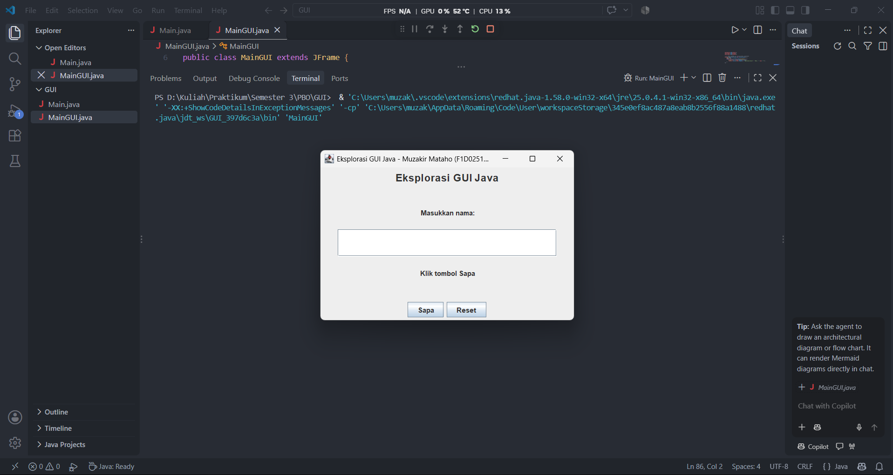
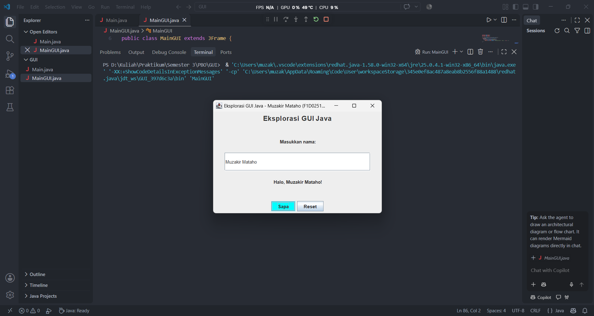

# PBO-GUI-SWING-EXPLORER
<div align="center">

# 🎨 Eksplorasi GUI Java (Swing & AWT)

### Tugas 3B – Latihan Graphical User Interface pada Java


</div>

---

## 👤 Identitas

| | |
|---|---|
| **Nama** | Muzakir Mataho |
| **NIM** | F1D02510018 |
| **Mata Kuliah** | Pemrograman Berorientasi Objek |
| **Tugas** | 3B – Latihan/Eksplorasi Materi GUI pada Java |

---

## 📸 Screenshot Aplikasi

<div align="center">

| Tampilan Awal | Setelah Interaksi |
|:---:|:---:|
|  |  |

</div>

---

## 🧩 5 Komponen Utama GUI yang Digunakan

### 1️⃣ Top-level Container → `JFrame`
Jendela utama aplikasi. Semua komponen lain diletakkan di dalamnya.
```java
JFrame frame = new JFrame("Judul");
frame.setDefaultCloseOperation(JFrame.EXIT_ON_CLOSE);
```

### 2️⃣ Intermediate Container → `JPanel`
Wadah perantara untuk mengelompokkan komponen sebelum dimasukkan ke `JFrame`.
Aplikasi ini memakai 3 panel: header, konten, dan tombol.

### 3️⃣ Atomic Component → `JLabel`, `JTextField`, `JButton`
Komponen dasar yang langsung berinteraksi dengan pengguna.

| Class | Fungsi |
|---|---|
| `JLabel` | Menampilkan teks |
| `JTextField` | Input teks dari pengguna |
| `JButton` | Tombol yang bisa diklik |

### 4️⃣ Layout Classes → `BorderLayout`, `GridLayout`, `FlowLayout`

| Layout | Digunakan pada |
|---|---|
| `BorderLayout` | Susunan utama frame (NORTH, CENTER, SOUTH) |
| `GridLayout` | Panel konten (baris & kolom rapi) |
| `FlowLayout` | Panel header & tombol (berjajar horizontal) |

### 5️⃣ Event Listener → `ActionListener` & `MouseAdapter`

| Interface/Class | Jenis | Fungsi |
|---|---|---|
| `ActionListener` | Interface | `actionPerformed()` dipanggil saat tombol diklik |
| `MouseAdapter` | Adapter Class | Override `mouseEntered()` & `mouseExited()` untuk efek hover |

---

## 🗂️ Struktur Repositori

```
📦 PBO-GUI-SWING-EXPLORER
 ┣ 📂 screenshot
 ┃ ┣ 🖼️ tampilan-awal.png
 ┃ ┗ 🖼️ tampilan-interaksi.png
 ┣ 📜 MainGUI.java
 ┗ 📜 README.md
```

## ▶️ Cara Menjalankan

```bash
cd src
javac MainGUI.java
java MainGUI
```

---

<div align="center">

Dibuat dengan ☕ oleh **Muzakir Mataho** (F1D02510018)

</div>
